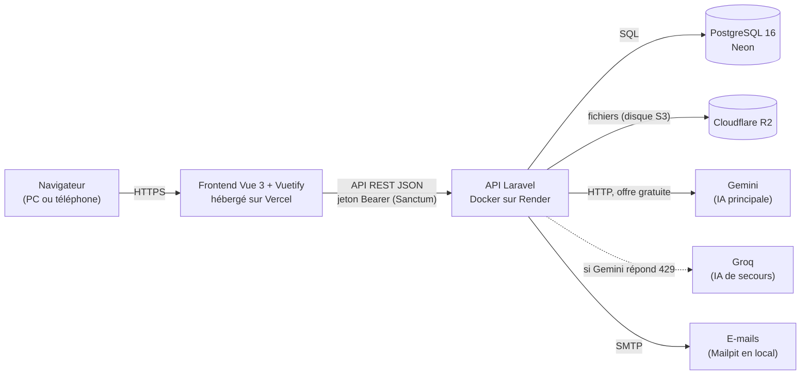
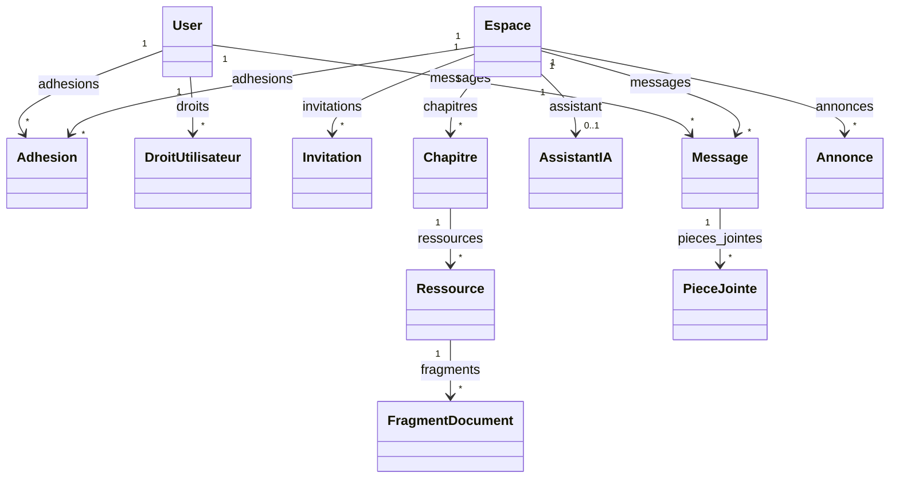
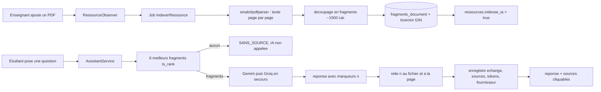

# Architecture

## 1. Vue d'ensemble



| Couche | Technologie | Rôle |
|---|---|---|
| Interface | Vue 3 (Composition API), Vuetify 3, Pinia, Vue Router, Axios | Écrans de la maquette, sur ordinateur et sur mobile |
| API | Laravel 13 + Sanctum 4 | Règles métier, droits, validation, accès aux données |
| Base de données | PostgreSQL 16 | Données ; recherche plein texte en français (`tsvector`) |
| Fichiers | Disque `local` en développement, Cloudflare R2 (compatible S3) en production | Pièces jointes et PDF de cours, jamais exposés directement |
| IA | Gemini (gratuit), Groq en secours (gratuit) | Réponses de l'Assistant de cours, avec citations |
| Local | Docker Compose : PostgreSQL et Mailpit | Même environnement pour toute l'équipe |

**Ce que nous n'utilisons pas, volontairement** : pas de microservice séparé pour l'IA (FastAPI), pas de WebSocket (les nouveaux messages arrivent par rafraîchissement régulier toutes les 5 secondes, avec le composable `usePolling`), et pas de base vectorielle (la recherche plein texte PostgreSQL suffit pour des PDF de cours).

## 2. Organisation du code

```
uniconnect/
├── backend/                      API Laravel
│   ├── app/Http/Controllers/     un contrôleur par ressource (Auth, Espace, Message, Ia, Admin/...)
│   ├── app/Http/Requests/        validation des formulaires (FormRequest), messages en français
│   ├── app/Http/Resources/       format JSON renvoyé au frontend
│   ├── app/Models/               modèles Eloquent (une classe par table de schema.sql)
│   ├── app/Notifications/        notifications de l'application (canal `database` de Laravel)
│   ├── app/Policies/             qui a le droit de faire quoi (EspacePolicy, MessagePolicy, ...)
│   ├── app/Services/             règles métier (EligibiliteService, GenerationGroupesService,
│   │                             RattachementService, IndexationService, AssistantService, ...)
│   ├── app/IA/                   ClientIA (interface), GeminiClient, GroqClient, ClientIAAvecSecours
│   ├── app/Jobs/                 tâches en arrière-plan (IndexerRessource)
│   ├── database/migrations/      reproduisent docs/conception/schema.sql
│   ├── database/seeders/         données de démonstration
│   ├── routes/api.php            toutes les routes (voir docs/api.md)
│   └── tests/                    tests Feature et Unit (PHPUnit)
├── frontend/                     Application Vue
│   ├── src/api/http.js           client Axios unique (jeton, 401, 422)
│   ├── src/stores/               Pinia : auth, espaces, ia, notifications, ...
│   ├── src/router/               routes et gardes (connecté, droit requis)
│   ├── src/layouts/              AppLayout (barre, menu, navigation basse), AuthLayout
│   ├── src/views/                une page par écran de la maquette
│   └── src/components/           composants réutilisables (EmptyState, SourcesCitees, ...)
├── docs/                         cette documentation
└── docker-compose.yml            PostgreSQL 16 + Mailpit
```

## 3. Sécurité

| Sujet | Règle |
|---|---|
| Authentification | Jeton **Sanctum** envoyé dans `Authorization: Bearer …` (ajouté par `src/api/http.js`). Le jeton est stocké dans `localStorage`. |
| Inscription | Seules les personnes de la table `comptes_autorises` de l'**année active** peuvent créer un compte. Activation par un lien signé, valable 48 h. |
| Connexion | Blocage pendant 15 min après 5 échecs ; un compte suspendu ou désactivé est refusé. |
| Droits | Le **profil** (étudiant, enseignant, administration) et les **droits** (`droits_utilisateur`) sont vérifiés **côté serveur** par des Policies et des Gates. Masquer un bouton dans l'interface ne suffit pas. |
| Espaces | Un non-membre reçoit **403** sur les messages, fichiers et ressources d'un espace, même avec un lien direct. |
| Fichiers | Téléchargement uniquement par une route protégée (vérification des droits, puis lien temporaire). Le chemin de stockage n'est jamais renvoyé. |
| Secrets | Clés et mots de passe uniquement dans `.env` (jamais dans Git, Jira ou WhatsApp). En production : variables d'environnement de Render et Vercel. |
| Validation | Tout ce qui arrive du frontend passe par une `FormRequest`. Les erreurs renvoient **422** avec les messages par champ. |

## 4. Fonctionnement de l'Assistant IA

### Indexation (quand un enseignant ajoute un PDF dans Ressources)

1. Le PDF est enregistré, puis le job `IndexerRessource` est lancé.
2. `smalot/pdfparser` extrait le texte, page par page.
3. Le texte est découpé en fragments d'environ 1 500 caractères (texte + numéro de page), enregistrés dans `fragments_document`.
4. PostgreSQL calcule automatiquement la colonne `recherche` (`to_tsvector('french', contenu)`), indexée en GIN.
5. `ressources.indexee_ia = true` : la puce « Indexée pour l'IA » s'affiche.

### Question d'un étudiant

```mermaid
sequenceDiagram
  actor E as Étudiant
  participant V as Vue (AssistantTab)
  participant L as Laravel (AssistantService)
  participant P as PostgreSQL
  participant G as Gemini
  participant Q as Groq
  E->>V: pose une question
  V->>L: POST /espaces/{id}/ia/questions
  L->>L: membre ? assistant actif ? quota (20/jour) ?
  L->>P: 6 meilleurs fragments (ts_rank)
  alt aucun fragment
    L-->>V: statut SANS_SOURCE (aucun appel IA)
  else fragments trouvés
    L->>G: consigne + extraits numérotés [1]…[6] + question
    alt Gemini répond 429 ou erreur
      L->>Q: même requête
    end
    G-->>L: réponse avec marqueurs [n]
    L->>L: relie [n] → fichier + page ; enregistre échange, sources, tokens, fournisseur
    L-->>V: { reponse, sources, statut, quota_restant }
  end
  V-->>E: réponse + sources cliquables
```

**Consigne envoyée à l'IA** (prompt système) : « Tu es l'assistant du cours. Réponds uniquement à partir des extraits numérotés fournis, en français. Après chaque information, cite le numéro de l'extrait entre crochets, par exemple [2]. Si la réponse n'y est pas, réponds exactement JE_NE_SAIS_PAS. »

**Limites des offres gratuites** :
- les quotas par minute et par jour sont limités ; on garde donc **20 questions par jour et par étudiant**, et les tests utilisent toujours le faux client `FakeClientIA` ;
- les données envoyées à l'offre gratuite de Gemini peuvent être réutilisées par Google : **on n'envoie que des extraits de cours**, jamais de données personnelles.

## 5. Données

- Schéma complet : [`conception/schema.sql`](conception/schema.sql) (32 tables), diagramme : [`conception/diagramme-classes.png`](conception/diagramme-classes.png).
- **Héritage du modèle UML** : une seule table `users`, avec une colonne `profil`, et une seule table `espaces`, avec une colonne `type` (`ORGANISATIONNEL`, `PRIVE`, `CHANNEL`).
- **Groupes organisationnels** : créés automatiquement à partir des référentiels (un groupe par classe et un seul groupe par matière, toutes classes confondues). La génération peut être relancée sans créer de doublons, grâce à l'index unique `espace_orga_unique`.
- **Rattachement** : à l'activation de son compte, un étudiant rejoint automatiquement son groupe de classe et les groupes des matières enseignées dans sa classe, et un enseignant devient propriétaire des groupes des matières dont il est responsable (`RattachementService`).

### Diagramme de classes (extrait)

Le diagramme complet est dans [`conception/diagramme-classes.png`](conception/diagramme-classes.png) (32 tables). Extrait des entités centrales, en Mermaid :



### Chaîne de l'Assistant IA (indexation puis question)



**Pourquoi des offres gratuites ?** Gemini et Groq proposent des quotas gratuits suffisants pour un cours (20 questions par jour et par étudiant). La recherche plein texte PostgreSQL (`tsvector`/`ts_rank`) évite une base vectorielle payante. Les données envoyées à l'IA sont **uniquement des extraits de cours**, jamais de données personnelles — les offres gratuites de Gemini peuvent réutiliser les données envoyées.

## 6. Choix techniques et raisons

| Choix | Pourquoi |
|---|---|
| Monorepo (backend + frontend dans un seul dépôt) | Une seule PR peut modifier l'API et l'écran qui l'utilise |
| Sanctum avec jeton Bearer, sans cookie | Simple quand le frontend (Vercel) et l'API (Render) sont sur deux domaines différents |
| Recherche plein texte PostgreSQL pour l'IA | Gratuit, déjà inclus dans la base, suffisant pour quelques dizaines de PDF |
| Gemini + Groq | Offres gratuites, sans carte bancaire ; l'interface `ClientIA` permet de changer de fournisseur dans `.env` |
| Rafraîchissement toutes les 5 s au lieu de WebSocket | Fonctionne avec l'offre gratuite de Render, sans serveur temps réel |
