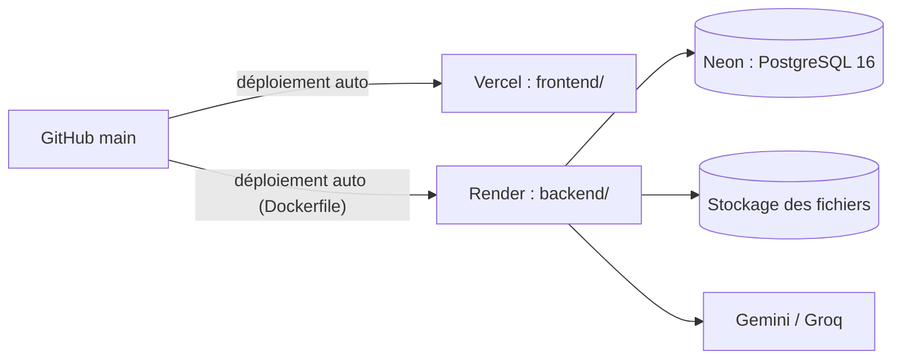

# Déploiement

Objectif : l'application est en ligne **avant le gel du 17/11 à 18 h**, avec uniquement des **offres gratuites**.



| Service | Rôle | Offre | Point d'attention |
|---|---|---|---|
| **Vercel** | Frontend Vue | Hobby (gratuite) | Dossier racine du projet : `frontend` |
| **Render** | API Laravel (Docker) | Free | Le service **s'endort après une période d'inactivité** : la première requête peut prendre environ une minute. Ouvrez `/api/health` 5 minutes avant la démo. |
| **Neon** | PostgreSQL 16 | Free | La base se met en pause sans activité, puis redémarre toute seule en quelques secondes |
| **Stockage des fichiers** | Pièces jointes, PDF de cours | Cloudflare R2 (prévu), ou une autre offre compatible S3 sans carte bancaire | Le disque de Render est **effacé à chaque déploiement** : ne stockez pas les fichiers dessus en production. Vérifiez si R2 demande une carte bancaire ; si oui, prenez une autre offre S3 gratuite qui n'en demande pas. |
| **Gemini / Groq** | Assistant IA | Gratuites | Voir SCRUM-43 pour créer les clés |

Les conditions des offres gratuites changent souvent : vérifiez-les au moment de créer les comptes.

## 1. Base de données (Neon)

1. Créez un compte sur neon.tech, puis un projet `uniconnect` (PostgreSQL 16, région Europe).
2. Copiez la **chaîne de connexion** (`postgresql://…`).
3. Ne la collez **nulle part ailleurs** que dans les variables d'environnement de Render.

## 2. API (Render)

Prérequis : `backend/Dockerfile` (SCRUM-30) avec nginx, php-fpm et supervisord.

1. Sur render.com : **New → Web Service** → dépôt GitHub `uniconnect`.
2. **Root Directory** : `backend` · **Runtime** : Docker · **Branch** : `main` · **Auto-Deploy** : oui.
3. **Health Check Path** : `/api/health`.
4. Ajoutez les variables d'environnement (tableau ci-dessous).
5. **Pre-Deploy Command**, ou au démarrage du conteneur : `php artisan migrate --force`.
6. Vérifiez que `https://<service>.onrender.com/api/health` renvoie `"db": "ok"`.

## 3. Frontend (Vercel)

1. Sur vercel.com : **Add New → Project** → dépôt `uniconnect`.
2. **Root Directory** : `frontend` · Framework : Vite · Build : `npm run build` · Output : `dist`.
3. Variable : `VITE_API_URL=https://<service>.onrender.com/api`.
4. Pour que les rafraîchissements de page fonctionnent avec Vue Router, ajoutez `frontend/vercel.json` :
   ```json
   { "rewrites": [{ "source": "/(.*)", "destination": "/index.html" }] }
   ```
5. Côté API, mettez l'URL Vercel dans `FRONTEND_URL` : elle sert pour CORS et pour les liens des e-mails (SCRUM-33).

## 4. Variables d'environnement

⚠️ **Jamais de valeur secrète dans Git, Jira, WhatsApp ou ce fichier.** On liste ici les noms, pas les valeurs.

### Render (backend)

| Variable | Valeur / rôle |
|---|---|
| `APP_NAME` | `UniConnect` |
| `APP_ENV` | `production` |
| `APP_KEY` | Clé générée avec `php artisan key:generate --show` (**secret**) |
| `APP_DEBUG` | `false` (jamais `true` en production) |
| `APP_URL` | URL Render de l'API |
| `APP_VERSION` | `1.0.0` |
| `FRONTEND_URL` | URL Vercel du frontend |
| `DB_CONNECTION` | `pgsql` |
| `DB_URL` | Chaîne de connexion Neon (**secret**). Ou `DB_HOST`, `DB_PORT`, `DB_DATABASE`, `DB_USERNAME`, `DB_PASSWORD`, avec `DB_SSLMODE=require` |
| `MAIL_MAILER`, `MAIL_HOST`, `MAIL_PORT`, `MAIL_USERNAME`, `MAIL_PASSWORD`, `MAIL_FROM_ADDRESS` | Service SMTP gratuit choisi pour les e-mails d'activation (**secret** pour le mot de passe) |
| `FILESYSTEM_DISK` | `s3` |
| `AWS_ACCESS_KEY_ID`, `AWS_SECRET_ACCESS_KEY`, `AWS_DEFAULT_REGION`, `AWS_BUCKET`, `AWS_ENDPOINT`, `AWS_USE_PATH_STYLE_ENDPOINT` | Stockage compatible S3 (**secrets**) |
| `LLM_PROVIDER` | `gemini` |
| `GEMINI_API_KEY`, `GEMINI_MODEL` | Clé gratuite Gemini (**secret**) et nom du modèle Flash |
| `GROQ_API_KEY`, `GROQ_MODEL` | Clé gratuite Groq (**secret**), `llama-3.3-70b-versatile` |
| `SESSION_DRIVER`, `CACHE_STORE`, `QUEUE_CONNECTION` | `database` |
| `LOG_CHANNEL` | `stderr` (les logs s'affichent dans Render) |

### Vercel (frontend)

| Variable | Valeur |
|---|---|
| `VITE_API_URL` | `https://<service>.onrender.com/api` |

## 5. Déployer

- **Fusionner une PR dans `main` suffit** : Render et Vercel déploient automatiquement.
- Suivre un déploiement : Render → service → **Events / Logs** ; Vercel → projet → **Deployments**.
- Après chaque déploiement, vérifiez : `/api/health` (`db: ok`), puis la connexion avec un compte de démo.
- Données de démonstration en production : `php artisan db:seed --class=DemoSeeder --force`, depuis le **Shell** de Render (SCRUM-188).

## 6. Revenir en arrière

| Problème | Action |
|---|---|
| Le dernier déploiement de l'API casse tout | Render → **Deploys** → choisir le déploiement précédent → **Rollback** |
| Le frontend est cassé | Vercel → **Deployments** → version précédente → **⋯ → Promote to Production** |
| Une migration a abîmé des données | Neon → **Branches / Restore** pour revenir à un instant précédent (selon la durée de conservation de l'offre gratuite). Corrigez ensuite le code par une PR. |
| Une clé a fuité (dans Git ou un message) | **Révoquez-la immédiatement** dans la console du service (Gemini, Groq, Neon…), créez-en une nouvelle et mettez-la à jour dans Render. Supprimer le commit ne suffit pas. |

## 7. Avant la démo du 19/11

- [ ] `/api/health` ouvert 5 minutes avant, pour réveiller Render
- [ ] Connexion des 3 comptes de démo (étudiant, enseignant, administration)
- [ ] Une question à l'Assistant IA répond avec des sources
- [ ] Un PDF se télécharge depuis Ressources
- [ ] Vidéo du plan B prête (voir [demo.md](demo.md))
