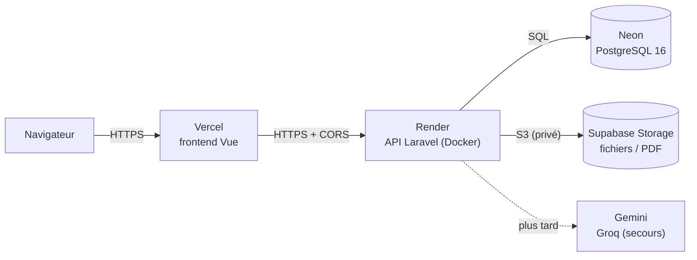

# Déploiement et retour arrière

Ce document est le **mode d'emploi de la production**. Il permet à n'importe quel membre de l'équipe de :

- comprendre où tourne l'application ;
- redéployer une version après une fusion sur `main` ;
- **revenir à la version précédente** si un déploiement casse quelque chose.

Objectif : l'application est en ligne **avant le gel du 17/11 à 18 h**, avec uniquement des **offres gratuites**.

## 1. Vue d'ensemble



Le navigateur ne parle **jamais directement** à Render : il charge l'application servie par Vercel, qui appelle ensuite l'API Render. Les fichiers (pièces jointes, PDF de cours) sont stockés dans un bucket **privé** Supabase Storage, par son API compatible S3 (SCRUM-138) ; l'Assistant IA utilise Gemini, avec Groq en secours.

| Service | Rôle | Offre | Point d'attention |
|---|---|---|---|
| **Vercel** | Frontend Vue | Hobby (gratuite) | Dossier racine du projet : `frontend` |
| **Render** | API Laravel (Docker) | Free | Le service **s'endort après une période d'inactivité** : la première requête peut prendre environ une minute. Ouvrez `/api/health` 5 minutes avant la démo. |
| **Neon** | PostgreSQL 16 | Free | La base se met en pause sans activité, puis redémarre toute seule en quelques secondes |
| **Supabase Storage** | Pièces jointes, PDF de cours | Free (1 Go, sans carte bancaire), projet `uniconnect-fichiers`, bucket privé `uniconnect-prod` | Le disque de Render est **effacé à chaque déploiement** : en production, `FILESYSTEM_DISK=s3`. Le projet gratuit se met en pause après une semaine sans activité : à réactiver depuis le tableau de bord Supabase. |
| **Gemini / Groq** | Assistant IA | Gratuites | Gemini par défaut, Groq en secours. Voir SCRUM-43 pour créer les clés. |

Les conditions des offres gratuites changent souvent : vérifiez-les au moment de créer les comptes.

### Production actuelle

Mise en place les 08/11 et 09/11 (SCRUM-31, SCRUM-32, SCRUM-33). État vérifié le 09/11/2026.

| Élément | Valeur |
|---|---|
| Frontend (Vercel) | https://uniconnect-six-lake.vercel.app |
| API (Render, service `uniconnect-api`, Frankfurt, offre Free) | https://uniconnect-api-qov1.onrender.com · santé : `/api/health` |
| Base (Neon, Frankfurt) | chaîne de connexion uniquement dans la variable Render `DB_URL` |
| Déploiement | automatique à chaque fusion sur `main` (Render et Vercel) |

## 2. Variables d'environnement

⚠️ **Jamais de valeur secrète dans Git, Jira, WhatsApp ou ce fichier.** On liste ici les **noms** et leur rôle, jamais les valeurs. Les valeurs réelles se trouvent uniquement dans les tableaux de bord Render et Vercel.

- Les modèles pour le développement local sont [`backend/.env.example`](../backend/.env.example) et [`frontend/.env.example`](../frontend/.env.example). Ces fichiers ne contiennent aucun secret.
- Sur Render : service `uniconnect-api` → onglet **Environment**. Toute modification déclenche un redéploiement.
- Sur Vercel : projet → **Settings → Environment Variables**. `VITE_*` est **intégré au build** : après un changement, il faut **Redeploy**.

### 2.1 API — Render

| Variable | Où | Rôle | Secret |
|---|---|---|---|
| `APP_NAME` | Render | Nom affiché (`UniConnect`) | Non |
| `APP_ENV` | Render | `production` | Non |
| `APP_KEY` | Render | Clé de chiffrement Laravel, générée avec `php artisan key:generate --show` | **Oui** |
| `APP_DEBUG` | Render | `false` — jamais `true` en production (sinon les erreurs exposent le code et les secrets) | Non |
| `APP_URL` | Render | URL publique de l'API (`https://uniconnect-api-qov1.onrender.com`) | Non |
| `APP_VERSION` | Render | Version exposée par `GET /api/health` (`1.0.0`) | Non |
| `FRONTEND_URL` | Render | URL Vercel du frontend. Sert au **CORS** et aux liens dans les e-mails | Non |
| `DB_CONNECTION` | Render | `pgsql` | Non |
| `DB_URL` | Render | Chaîne de connexion Neon complète (`postgresql://…`). **Seul endroit où elle est stockée** | **Oui** |
| `DB_SSLMODE` | Render | `require` si vous utilisez les variables séparées ci-dessous plutôt que `DB_URL` | Non |
| `DB_HOST`, `DB_PORT`, `DB_DATABASE`, `DB_USERNAME`, `DB_PASSWORD` | Render | Variante de connexion Neon sans `DB_URL` (les deux méthodes ne se cumulent pas) | **Oui** pour `DB_PASSWORD` |
| `SESSION_DRIVER` | Render | `database` | Non |
| `CACHE_STORE` | Render | `database` | Non |
| `QUEUE_CONNECTION` | Render | `database` — les e-mails et traitements passent par la file | Non |
| `LOG_CHANNEL` | Render | `stderr` — les logs s'affichent directement dans Render | Non |
| `PORT` | Render | `80` — nginx écoute sur le port 80 dans le conteneur | Non |
| `MAIL_MAILER` | Render | Pilote d'envoi des e-mails (`smtp`) | Non |
| `MAIL_HOST` | Render | Hôte SMTP du service gratuit choisi | Non |
| `MAIL_PORT` | Render | Port SMTP (`587` en général) | Non |
| `MAIL_SCHEME` | Render | `smtp` ou `smtps` selon le fournisseur (Laravel 13 n'utilise plus `MAIL_ENCRYPTION`) | Non |
| `MAIL_USERNAME` | Render | Identifiant SMTP | Non |
| `MAIL_PASSWORD` | Render | Mot de passe SMTP | **Oui** |
| `MAIL_FROM_ADDRESS` | Render | Adresse d'expéditeur des e-mails d'activation | Non |
| `MAIL_FROM_NAME` | Render | Nom d'expéditeur (`UniConnect`) | Non |
| `FILESYSTEM_DISK` | Render | `s3` (bucket Supabase). `local` n'est pas persistant sur Render | Non |
| `AWS_ACCESS_KEY_ID` | Render | Access key ID S3 de Supabase (section 3.6) | **Oui** |
| `AWS_SECRET_ACCESS_KEY` | Render | Secret access key S3 de Supabase | **Oui** |
| `AWS_DEFAULT_REGION` | Render | Région du projet Supabase : `eu-central-1` | Non |
| `AWS_BUCKET` | Render | `uniconnect-prod` | Non |
| `AWS_ENDPOINT` | Render | `https://<ref-du-projet>.storage.supabase.co/storage/v1/s3` (Storage → S3 Configuration) | Non |
| `AWS_USE_PATH_STYLE_ENDPOINT` | Render | `true` (obligatoire pour Supabase) | Non |
| `LLM_PROVIDER` | Render | `gemini` par défaut, `groq` pour basculer sur le secours (prévu) | Non |
| `GEMINI_API_KEY` | Render | Clé gratuite Google Gemini — **ne jamais la commiter ni la copier dans un ticket** (prévu) | **Oui** |
| `GEMINI_MODEL` | Render | Modèle Gemini utilisé, `gemini-3.5-flash-lite` (prévu) | Non |
| `GROQ_API_KEY` | Render | Clé gratuite Groq, utilisée en secours (prévu) | **Oui** |
| `GROQ_MODEL` | Render | Modèle Groq de secours, `openai/gpt-oss-120b` (`llama-3.3-70b-versatile` n'existe plus) (prévu) | Non |

> Les lignes marquées **prévu** concernent l'Assistant IA : ne les créez que lorsque la fonctionnalité est livrée. Les noms sont déjà fixés par `backend/config/filesystems.php` et `backend/.env.example`.

### 2.2 Frontend — Vercel

| Variable | Où | Rôle | Secret |
|---|---|---|---|
| `VITE_API_URL` | Vercel | URL de l'API appelée par le navigateur : `https://uniconnect-api-qov1.onrender.com/api`. À définir pour **Production** *et* **Preview** | Non |
| `VITE_SANS_CONNEXION` | Vercel | `false`. Réservé au développement local (`true` ouvre les pages sans connexion) ; ne pas l'activer en production | Non |

`VITE_API_URL` est **figée au moment du build**. Si vous la changez, cliquez sur **Redeploy** : modifier la variable seule ne met pas à jour le site déjà en ligne.

## 3. Déployer

### 3.1 Déploiement normal

**Fusionner une Pull Request dans `main` suffit.** Render et Vercel détectent le commit et déploient automatiquement.

1. La PR est relue et fusionnée dans `main` (bouton **Squash and merge** sur GitHub : c'est le seul mode de fusion autorisé, SCRUM-29).
2. Render reconstruit l'image Docker de l'API et redémarre le service. Les migrations sont lancées automatiquement au démarrage par `backend/docker/start.sh` (`php artisan migrate --force`) : **il n'y a pas de Pre-Deploy Command à configurer**.
3. Vercel reconstruit le frontend et met à jour l'URL de production.
4. Vérifiez le résultat (voir 3.3).

> Si un service n'a pas bronché, vérifiez que le dépôt est bien connecté via **GitHub** (et non via l'URL publique) : Render ne reçoit alors pas les notifications de fusion.

### 3.2 Suivre les logs

**Render (API)**

- **Logs** : journal en direct du conteneur (requêtes, erreurs Laravel, worker de file, scheduler). C'est là qu'apparaissent les erreurs de migration ou de connexion à Neon.
- **Events** : historique des déploiements, avec le commit et le statut.
- Un onglet **Build Logs** séparé montre la construction Docker ; les erreurs de `composer install` ou de `npm` y figurent.
- Cherchez en priorité `Migration`, `ERROR`, `SQLSTATE`, `Segmentation fault`.

**Vercel (frontend)**

- **Deployments** : chaque déploiement avec son commit, son auteur et son statut (*Building*, *Ready*, *Error*).
- Cliquez sur un déploiement → **Building** / **Build Logs** pour voir la compilation Vite.
- L'URL de production est toujours `https://uniconnect-six-lake.vercel.app` ; chaque PR reçoit en plus une **Preview URL** commentée sur la PR.
- Les Preview URLs sont protégées par la connexion Vercel : un membre extérieur au projet Vercel est redirigé vers la page de connexion. Pour que toute l'équipe puisse les ouvrir : **Settings → Deployment Protection** → désactiver *Vercel Authentication* (ou inviter les membres dans l'équipe Vercel).

### 3.3 Vérifier après un déploiement

1. `https://uniconnect-api-qov1.onrender.com/api/health` doit répondre `200` avec `"db": "ok"`.
2. Ouvrez le frontend et vérifiez qu'il se charge (une première requête peut réveiller Render, comptez jusqu'à une minute).
3. Rafraîchissez une route profonde, par exemple `/espaces/3` : elle doit renvoyer l'application et non une 404 (réécritures SPA de `frontend/vercel.json`).
4. Connectez-vous avec un compte de démo et vérifiez qu'un appel à l'API fonctionne (aucune erreur CORS dans la console du navigateur).
5. Si une erreur apparaît, passez à la section 4 (retour arrière) sans attendre.

### 3.4 Redéployer manuellement

Utile pour relancer un build après une erreur intermittente, ou pour appliquer un changement de variable d'environnement.

- **Render** : service → bouton **Manual Deploy** → **Deploy latest commit**. Pour repartir de zéro, utilisez **Clear build cache & deploy**.
- **Vercel** : **Deployments** → déploiement de son choix → **⋯** → **Redeploy**.

### 3.5 Données de démonstration

Depuis le **Shell** de Render (SCRUM-188) :

```sh
su -s /bin/sh www-data -c "php artisan db:seed --class=DemoSeeder --force"
```

Le Shell s'ouvre en `root` : passez par `www-data` pour ne pas créer de fichiers appartenant à `root` dans `storage/`.

**Sans Shell (offre gratuite de Render)** : ajoutez la variable `SEED_DEMO=true` (Environment), laissez Render redéployer, vérifiez dans les logs que `DemoSeeder` s'est exécuté, puis **supprimez la variable**. Le seeder est idempotent : il met à jour les comptes de démo sans créer de doublons. Les comptes de démo ont un mot de passe public (README) : ne les gardez pas après la soutenance.

### 3.6 Stockage des fichiers (Supabase Storage)

SCRUM-138. Le disque de Render est effacé à chaque déploiement : en production, les fichiers vont dans un bucket **privé** de Supabase Storage, par son API compatible S3 (disque `s3` de Laravel, paquet `league/flysystem-aws-s3-v3`). Le navigateur ne reçoit **jamais** d'URL du bucket : chaque téléchargement passe par l'API, qui vérifie les droits puis relit le fichier.

1. **Projet et bucket** (déjà faits) : projet `uniconnect-fichiers` (région `eu-central-1`, comme Render), bucket `uniconnect-prod`, **privé**, 25 Mo maximum par fichier.
2. **Clés S3** : tableau de bord Supabase → projet `uniconnect-fichiers` → **Storage** → **S3 Configuration** → **New access key**. Notez l'*Access key ID* et la *Secret access key* (affichée une seule fois). Ces clés donnent un accès complet au stockage : **uniquement côté serveur**, jamais dans Git, un ticket ou une conversation.
3. **Render** → Environment : ajoutez les 7 variables `FILESYSTEM_DISK` et `AWS_*` du tableau de la section 2.1 (l'endpoint se copie depuis la même page *S3 Configuration*). Render redéploie.
4. **Vérification** : envoyez une pièce jointe ou une ressource depuis l'application en ligne, puis ouvrez **Storage** → `uniconnect-prod` : le fichier doit apparaître sous `espaces/<id>/…`. Téléchargez-le ensuite depuis l'application.

Les fichiers envoyés **avant** le passage à `s3` étaient sur le disque de Render : ils ont déjà été perdus au déploiement suivant.

## 4. Revenir en arrière

Le retour arrière se fait **service par service** : revenir sur Render ne change pas le frontend, et inversement.

| Problème | Action |
|---|---|
| **Le dernier déploiement de l'API casse tout** | Render → service → **Deploys** → repérez le dernier déploiement *Live* **avant** le problème → **Rollback**. Render redéploie cette version, sans reconstruction. |
| **Le frontend est cassé** | Vercel → projet → **Deployments** → ouvrez le déploiement précédent qui fonctionnait → **⋯** → **Promote to Production**. L'URL de production bascule immédiatement, sans rebuild. |
| **Seule une variable d'environnement a changé** | Corrigez la variable dans Render ou Vercel, puis redéployez (3.4). Un *Rollback* Render ne restaure pas les variables d'environnement. |
| **Une migration a abîmé des données** | Neon → **Branches / Restore** pour revenir à un instant précédent (la durée de conservation dépend de l'offre gratuite). Corrigez ensuite le code par une PR. Le rollback Render ne défait **pas** les migrations déjà exécutées. |
| **Une clé a fuité** (Git, ticket, message) | **Révoquez-la immédiatement** dans la console du service (Gemini, Groq, Neon, SMTP…), créez-en une nouvelle et mettez-la à jour dans Render. Supprimer le commit ne suffit pas : l'historique Git reste. |

À savoir avant de cliquer sur *Rollback* :

- Le rollback Render ou Vercel revient à un **commit précédent**, mais ne modifie **pas** `main`. Le prochain merge sur `main` redéploiera le code cassé : ouvrez tout de suite une **PR de revert** (ou corrigez le bug) pour que `main` redevienne sain.
- Un rollback Render peut échouer si la base a déjà appliqué une migration incompatible avec l'ancien code. Dans ce cas, restaurez la base (Neon) ou corrigez le code et redéployez.
- Après un rollback, revalidez avec la liste de la section 3.3.

## 5. Relecture par un membre non impliqué

Cette procédure doit être testée par **un membre qui n'a pas participé au déploiement**, puis validée ici avant de clôturer SCRUM-34.

- [ ] J'ai trouvé les URLs de production et l'endpoint `/api/health` sans aide.
- [ ] J'ai identifié où se trouve chaque variable d'environnement (Render ou Vercel), sans qu'on me donne de valeur secrète.
- [ ] J'ai compris qu'une fusion sur `main` suffit à déployer, et où suivre les logs Render et Vercel.
- [ ] J'ai compris comment revenir en arrière sur Render (*Deploys → Rollback*) et sur Vercel (*Deployments → Promote to Production*).
- [ ] J'ai compris qu'il faut une PR de revert pour que `main` redevienne sain après un rollback.
- [ ] J'ai repéré la procédure en cas de fuite de clé.

| Relu par | Date | Remarque |
|---|---|---|
| _à compléter_ | | |

## 6. Problèmes déjà rencontrés

- `could not open certificate file "/root/.postgresql/postgresql.crt": Permission denied` dans les logs, et worker de queue qui redémarre en boucle : les processus `www-data` avaient `HOME=/root`. Corrigé dans `backend/docker/supervisord.conf` (`environment=HOME="/var/www"`, PR #25).
- Le premier build a planté pendant `composer install` (*Segmentation fault*) : erreur intermittente côté Render, **Manual Deploy → Deploy latest commit** suffit.
- Un autre build a échoué pendant `composer install` avec `curl error 28` / `curl error 56` (téléchargements depuis `api.github.com` trop lents) : problème réseau passager, même solution (relancer le déploiement).
- Ordre des déploiements lors d'un changement d'URL : déployez d'abord l'API, puis mettez à jour `VITE_API_URL` côté Vercel et redéployez le frontend. Sinon le navigateur appelle une ancienne API.
- CORS : `FRONTEND_URL` doit contenir l'URL Vercel **sans slash final**. Les Preview URLs sont autorisées par le motif défini dans `backend/config/cors.php`, lié au compte Vercel de l'équipe : si le compte ou le nom du projet change, mettez à jour ce motif.
- Rappel : toute modification de `VITE_API_URL` exige un **Redeploy** Vercel (variable intégrée au build).

## 7. Avant la démo du 19/11

- [ ] `/api/health` ouvert 5 minutes avant, pour réveiller Render
- [ ] Connexion des 3 comptes de démo (étudiant, enseignant, administration)
- [ ] Une question à l'Assistant IA répond avec des sources
- [ ] Un PDF se télécharge depuis Ressources
- [ ] Vidéo du plan B prête (voir [demo.md](demo.md))
