# Guide utilisateur UniConnect

UniConnect est la messagerie de votre université. Vous y retrouvez automatiquement les espaces de votre classe et de vos matières, et un **Assistant IA** qui répond à vos questions à partir des supports de vos enseignants.

Il fonctionne sur ordinateur et sur téléphone. Sur téléphone, le menu est en bas de l'écran.

> Les captures d'écran viennent de l'application lancée en local avec les données de démonstration (`DemoSeeder` et quelques messages d'exemple) : l'interface est celle de la production, seules les données diffèrent. Elles sont rangées dans `docs/images/guide/`.

---

## 1. Créer et activer son compte (tout le monde)

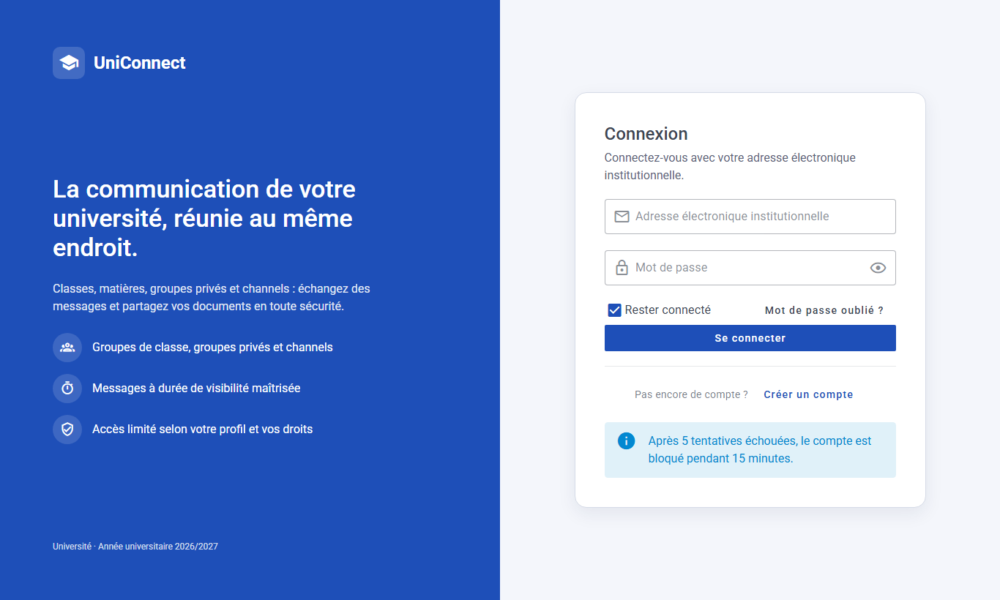

1. Ouvrez UniConnect, puis cliquez sur **Créer mon compte**.
2. Saisissez votre **matricule**, votre nom, votre prénom et votre **adresse e-mail de l'université** (`…@univ.tn`). Cochez la charte, puis validez.
   - Message « Cette adresse ne figure pas sur la liste des comptes autorisés » : vérifiez l'adresse, sinon contactez la scolarité.
3. Ouvrez l'e-mail reçu et cliquez sur le lien d'activation (**valable 48 heures**). S'il a expiré, cliquez sur **Renvoyer l'e-mail d'activation**.
4. Choisissez votre mot de passe : 8 caractères minimum, avec une majuscule, une minuscule et un chiffre.
5. C'est fait : vous êtes connecté et vous avez rejoint automatiquement vos espaces.

**Connexion** : adresse e-mail + mot de passe. Après **5 erreurs**, le compte est bloqué **15 minutes**.

---

## 2. Étudiant

### Retrouver ses espaces

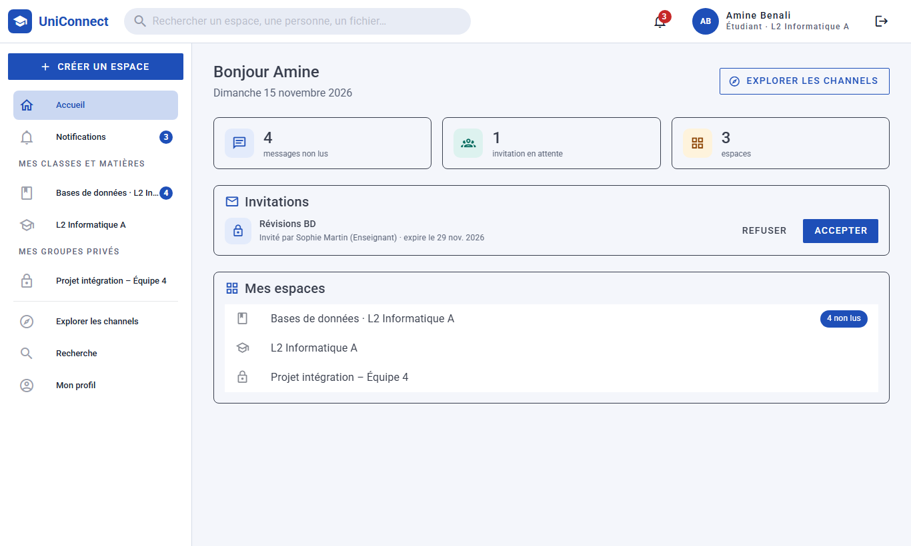

Le **menu de gauche** classe vos espaces en trois rubriques : **Mes classes et matières**, **Mes groupes privés** et **Mes channels**. Le chiffre bleu à côté d'un espace indique le nombre de messages non lus ; il revient à zéro quand vous ouvrez la discussion.

L'**accueil** résume votre journée : messages non lus, invitations en attente et nombre d'espaces, puis la liste de vos invitations et de vos espaces (pratique sur téléphone, où le menu est replié).

### Discuter

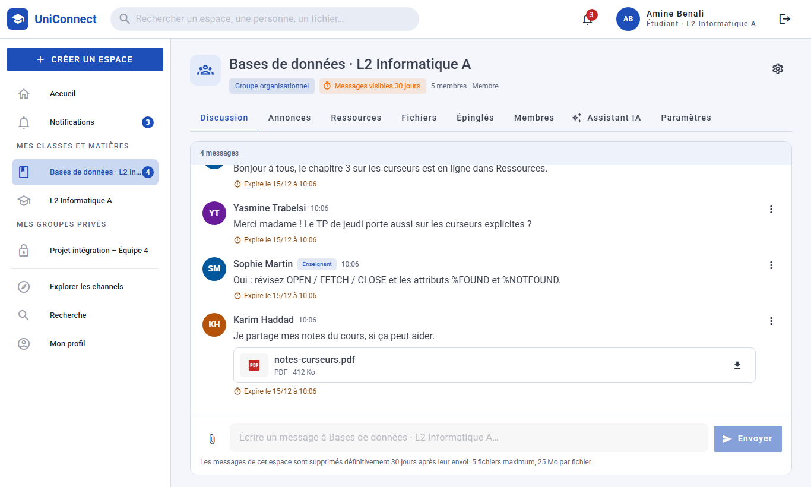

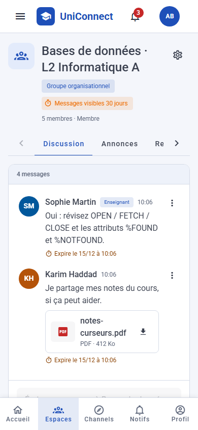

1. Ouvrez un espace : l'onglet **Discussion** s'affiche.
2. Écrivez en bas, puis cliquez sur **Envoyer** (ou appuyez sur Entrée).
3. Pour joindre un fichier, cliquez sur le trombone 📎 ou faites glisser le fichier dans la zone d'écriture (« Déposez vos fichiers ici »). On peut envoyer un fichier seul, sans texte.

### Fichiers joints
- **5 fichiers** au maximum par message, **25 Mo** par fichier.
- Formats acceptés : PDF, images (JPG, PNG, GIF, WebP), Word, Excel, PowerPoint et ZIP.
- Sous le message, cliquez sur le fichier pour le **télécharger** ; une image peut aussi s'ouvrir en **aperçu**.
- Les fichiers sont **réservés aux membres** de l'espace : quelqu'un qui quitte l'espace, ou qui en est retiré, ne peut plus les ouvrir, même avec un lien copié auparavant.

### Annonces

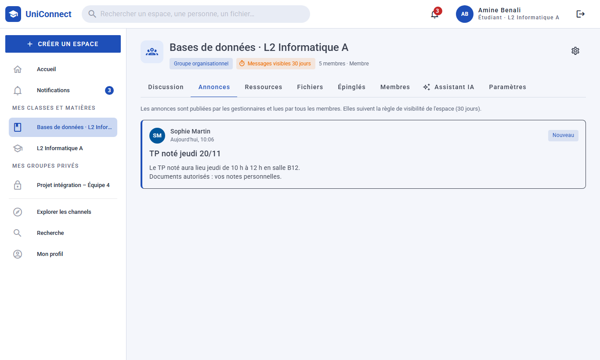

L'onglet **Annonces** regroupe les informations officielles de l'enseignant, séparées de la discussion (dates d'examen, consignes…). Une annonce publiée depuis moins de 3 jours porte la mention **Nouveau** ; ses pièces jointes se téléchargent comme les fichiers des messages. Chaque nouvelle annonce vous envoie une notification.

### Ressources

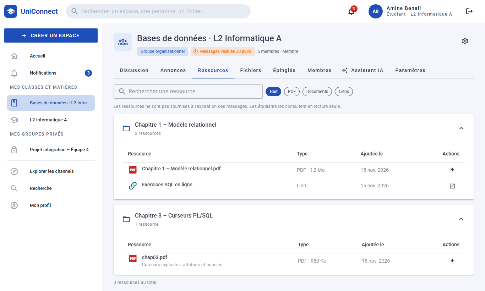

L'onglet **Ressources** présente les supports de cours **classés par chapitre**.
- Le champ **Rechercher une ressource** et les filtres par type (PDF, documents, liens) aident à retrouver un support.
- Cliquez sur l'icône de téléchargement pour enregistrer un fichier, ou sur l'icône d'ouverture pour suivre un lien.

### Notifications

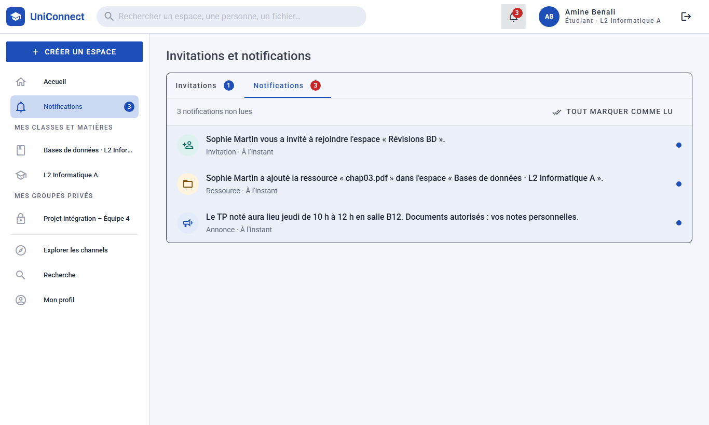

La cloche 🔔 en haut de l'écran affiche le nombre de notifications **non lues** ; le compteur se met à jour tout seul toutes les 30 secondes. La page **Invitations et notifications** a deux onglets :
- **Invitations** : accepter ou refuser une invitation à rejoindre un espace ;
- **Notifications** : nouvelle annonce, nouvelle ressource, retrait d'un espace… Un point bleu signale une notification non lue ; un clic la marque comme lue et ouvre la page concernée. **Tout marquer comme lu** les marque toutes d'un coup.

### Poser une question à l'Assistant IA

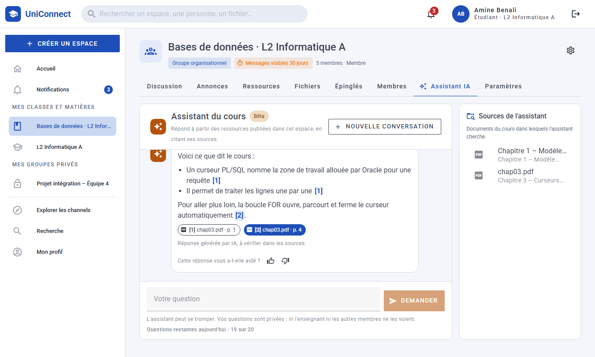

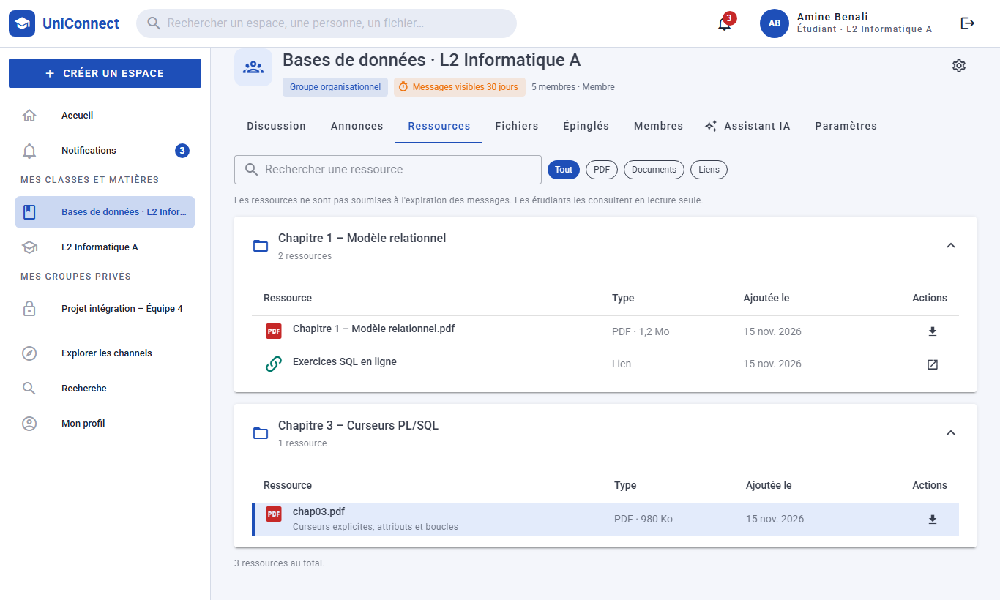

1. Dans l'espace d'une matière, ouvrez l'onglet **Assistant IA** (visible si l'enseignant l'a activé).
2. Posez votre question en français, par exemple : « Quelle est la différence entre la 2FN et la 3FN ? »
3. La réponse indique ses **sources** (« [1] Chapitre 3 – Normalisation.pdf · p. 14 »). Dans le texte, cliquez sur un numéro comme **[1]** pour mettre en évidence la source correspondante, puis cliquez sur la source : l'onglet **Ressources** s'ouvre, le document est **surligné** dans son chapitre et prêt à être téléchargé.
4. Sur ordinateur, le panneau **Sources de l'assistant**, à droite, liste les documents du cours dans lesquels l'assistant cherche ; un clic ouvre le document de la même façon.
5. Donnez votre avis sous la réponse avec 👍 (réponse utile) ou 👎 (pas utile) : cela aide l'enseignant à améliorer ses supports.

À savoir :
- l'assistant répond **uniquement à partir des documents du cours**. Si l'information n'y est pas, il le dit ;
- **20 questions par jour** au maximum, tous espaces confondus (le compteur s'affiche sous la zone de saisie) ;
- vos questions sont **privées** : ni l'enseignant ni les autres étudiants ne les voient ;
- l'IA peut se tromper : **vérifiez toujours dans les sources**.

### Groupes privés

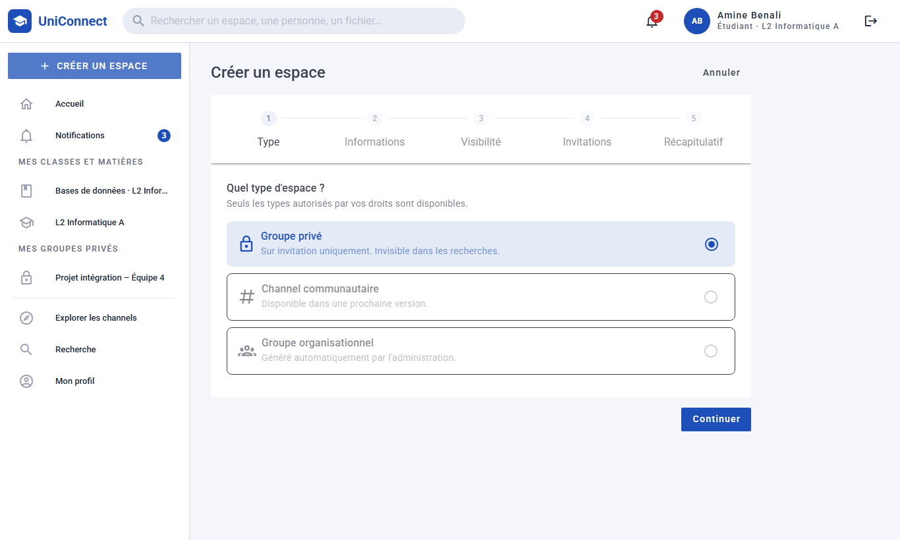

1. Cliquez sur **Créer un espace** (en haut du menu), puis suivez les 5 étapes : type, informations (nom, description), visibilité des messages (24 h, 7 jours ou 30 jours), invitations, récapitulatif.
2. Pour inviter quelqu'un, tapez au moins 2 lettres de son **nom ou prénom** (la recherche ne se fait pas par adresse e-mail).
3. Les invités voient l'invitation sur leur **accueil** (et un chiffre sur la cloche 🔔) et choisissent **Accepter** ou **Refuser**. Une invitation expire au bout de 14 jours.
4. Vous pouvez quitter un groupe privé (onglet **Membres** → **Quitter l'espace**), mais pas le groupe de votre classe.

### Assistant IA : bonnes pratiques
- **Posez une question précise**, sur une notion du cours : « Quels sont les attributs d'un curseur explicite ? » plutôt que « Explique le chapitre 3 ».
- **Une question à la fois** : l'assistant cherche les passages du cours qui correspondent à vos mots ; une question qui mélange plusieurs sujets donne une réponse moins fiable.
- **Reprenez les mots du cours** (« normalisation », « clé étrangère »…) : ils aident l'assistant à trouver le bon passage.
- **Vérifiez les sources** : chaque information est suivie d'un numéro [n] qui renvoie à un document et à une page. Une réponse sans source n'est pas fiable.
- Si l'assistant répond qu'il n'a **pas trouvé de réponse fiable** dans les ressources, l'information n'est pas dans les supports publiés : demandez à votre enseignant.
- Gardez vos **20 questions par jour** pour les points difficiles ; **Nouvelle conversation** repart de zéro quand vous changez de sujet.

---

## 3. Enseignant

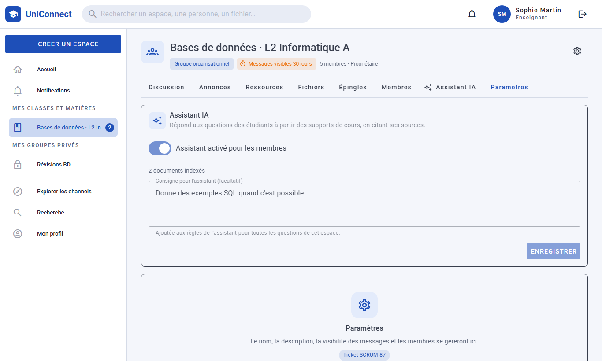

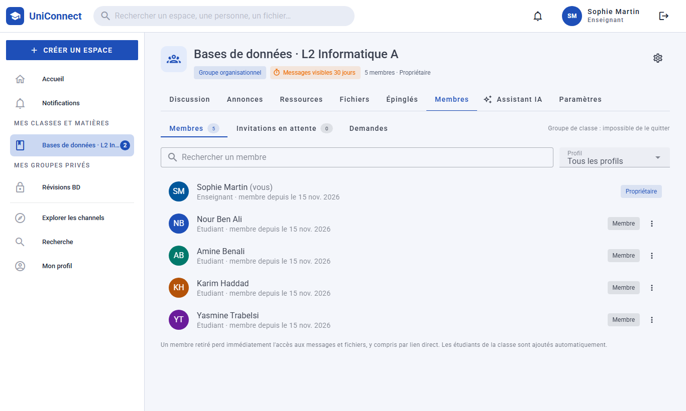

Vous avez accès à tout ce que fait un étudiant, et en plus :

| Action | Où | Comment |
|---|---|---|
| Publier une annonce | Onglet **Annonces** | **Nouvelle annonce** → titre, contenu, pièces jointes (facultatives) → **Publier**. Les membres reçoivent une notification ; cochez **Notifier aussi les membres par e-mail** pour leur envoyer un e-mail en plus. Seul l'auteur peut supprimer son annonce. |
| Partager un support de cours | Onglet **Ressources** | **Nouveau chapitre**, puis **Ajouter une ressource** : un fichier (PDF, Word…) ou un lien. Le menu ⋮ d'une ressource permet de la **renommer**, de la **déplacer** vers un autre chapitre ou de la **supprimer**. Les PDF sont indexés pour l'IA en arrière-plan : la puce « Indexé pour l'IA » apparaît (visible des enseignants seulement). |
| Activer l'Assistant IA | Onglet **Paramètres**, bloc « Assistant IA » | Activez l'interrupteur (« Assistant activé pour les membres ») : l'onglet **Assistant IA** apparaît pour les membres. Ajoutez si besoin une **consigne** (1 000 caractères au maximum), par exemple « Donne des exemples SQL », puis **Enregistrer**. |
| Gérer les membres | Onglet **Membres** | Inviter, nommer un co-gestionnaire, retirer un membre (l'accès aux messages est coupé immédiatement), transférer la propriété. Un espace a toujours un propriétaire : s'il part, la propriété passe au plus ancien co-gestionnaire. |

Conseil : l'assistant n'est utile que si vos PDF sont **en texte** (pas des scans d'images) et classés par chapitre.

---

## 4. Membre de l'administration

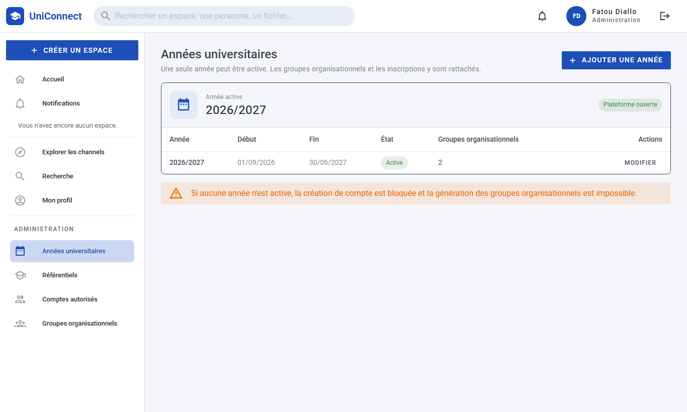

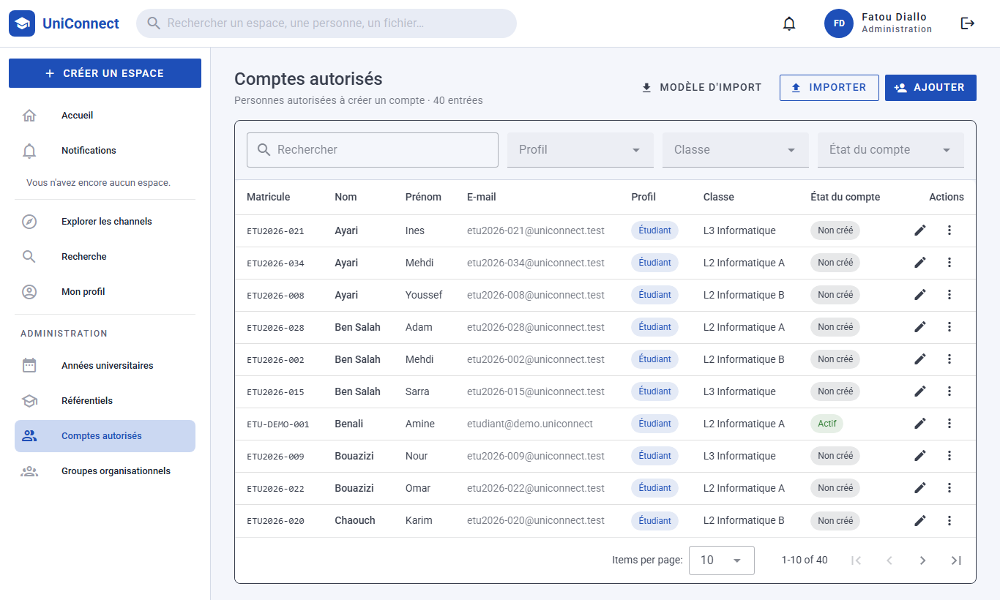

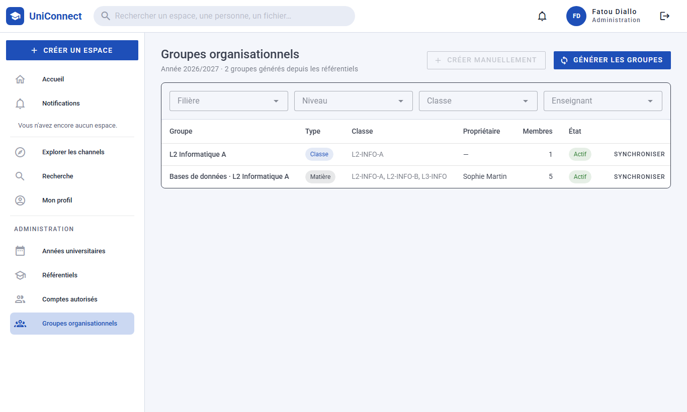

Menu **ADMINISTRATION** (visible seulement avec les droits correspondants) :

| Écran | À quoi il sert |
|---|---|
| **Années universitaires** | Créer l'année suivante, puis l'**activer** au bon moment (une seule année active à la fois) |
| **Référentiels** | Départements, filières, niveaux, classes et matières. Un élément utilisé ne peut pas être supprimé. |
| **Comptes autorisés** | Liste des personnes qui peuvent créer un compte. **Importer un fichier Excel** : un aperçu montre les erreurs ligne par ligne avant d'importer. |
| **Groupes organisationnels** | **Générer les groupes** de l'année active : un groupe par classe et un par matière. On peut relancer sans risque, sans créer de doublons. |

Format du fichier Excel : colonnes `matricule`, `nom`, `prenom`, `email`, `profil`, `classe_code` (première feuille, `profil` = ETUDIANT / ENSEIGNANT / ADMINISTRATION).

---

## 5. Questions fréquentes

| Question | Réponse |
|---|---|
| Je ne reçois pas l'e-mail d'activation | Vérifiez vos spams, puis cliquez sur « Renvoyer l'e-mail d'activation ». |
| J'ai oublié mon mot de passe | La réinitialisation en ligne arrive dans une prochaine version. En attendant, contactez la scolarité. |
| Je ne vois pas l'onglet Assistant IA | L'enseignant ne l'a pas encore activé pour cette matière. |
| « Vous avez atteint vos 20 questions du jour » | Le quota se remet à zéro le lendemain. |
| « L'assistant est momentanément indisponible » | Le service d'IA est saturé : réessayez dans quelques minutes. |
| Un message ou un fichier a disparu | Il a peut-être été supprimé par son auteur, ou vous n'êtes plus membre de l'espace. |
| « Le fichier dépasse la taille maximale de 25 Mo » | Compressez le fichier ou partagez un lien (onglet Ressources pour un enseignant). 5 fichiers au maximum par message. |
| Je ne peux plus ouvrir un fichier (accès refusé) | Les fichiers sont réservés aux membres de l'espace : si vous avez quitté l'espace ou en avez été retiré, demandez une nouvelle invitation. |
